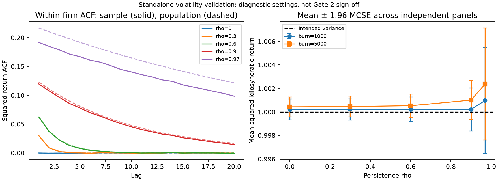
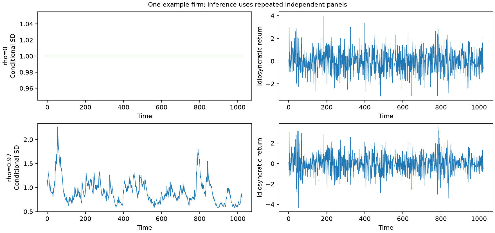
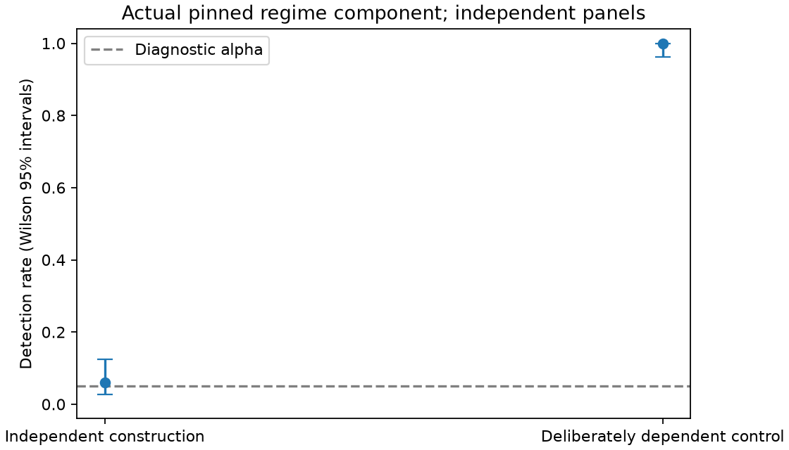

# Deeptanshu Kumar: Week 1 and Week 2 deliverable

31 October 2026. Standalone firm-level volatility, validation, and Monte Carlo
protocol. Implemented with user approval on `deeptanshu/garch-validation-audit`.
This is component evidence for team review, not Gate 2/Gate 3 approval. The local
code/draft deliverables are ready; verification against a confirmed frozen regime
version and the integrated event-window mapping remains pending.

## What is delivered

| Week | Assignment | Delivered |
| --- | --- | --- |
| 1 | Modular firm-level volatility and persistence dial | NumPy GARCH(1,1), documented shapes/units, explicit RNG and initialization |
| 1 | Example volatility/return series and low/high persistence | Reproducible selected series, path plots, sample/population squared-return ACF |
| 1 | Preserve unconditional variance | Fixed intercept mapping, analytic/recurrence tests, empirical variance summaries |
| 2 | Stability, burn-in, moments and pathology sweeps | Five rho settings × two burn-ins × 32 panels, repeated with a separate root seed |
| 2 | Volatility/regime separation and dependent positive control | Actual pinned teammate source, full-process randomization, input/RNG audit |
| 2 | Coverage, size and MCSE tested on mock intervals | Reusable array API, failure policy, paired differences and standalone CSV CLI |
| 2 | Monte Carlo pre-specification draft | Budgets, materiality and manipulation-check proposals in decision notes P5 |
| STRETCH | Runtime scaling | Local GARCH-only timing grid and returned-array memory requirements |

Fold-split review remains unavailable because no DML/fold implementation was
found. No other teammate's scientific track has been implemented or merged.

## Methods and interfaces

`simulate_volatility(n_firms, n_periods, persistence, rng, *,
unconditional_variance=1.0, arch_share=0.1, burn_in=1000)` returns `sigma, eps`,
each shaped `(firm,time)`. sigma is conditional standard deviation; eps is
standardized iid Gaussian innovation; idiosyncratic return e=sigma*eps.

With rho=persistence, a=arch_share and intended unconditional variance v:
alpha=a*rho; beta=rho-alpha; omega=v*(1-rho).
The recursion is h[i,t]=omega+alpha*e[i,t-1]^2+beta*h[i,t-1]. Only own idiosyncratic
returns enter it. No regime, factor or treatment input is accepted. h[:,0]=v;
this initializes the mean, not the stationary distribution, so burn-in is explicit.
Changing rho also changes higher moments and shock responsiveness along this
parameterized family; it is not a pure intervention on decay with all else fixed.

Finite unconditional variance requires rho<1. Gaussian fourth moments additionally
require rho²+2alpha²<1; population squared-return ACFs are unavailable outside that
condition. Numerical failures raise with a time index and are recorded by the
harness. Large finite returns are logged, never clipped or normalized away.
These choices follow Bollerslev (1986), Sections 2-4; see the
[decision record](../docs/DECISIONS.md) for alternatives and assumptions.

## Stability and persistence results

[Primary machine-readable summary](../results/tables/week1_week2_validation.json)
uses seed 20261031, 64 firms, 4,096 retained periods, rho in
{0,.3,.6,.9,.97}, burn-in 1,000/5,000, and 32 independent replications *within each
setting*. Innovations are reused across rho and burn-in for paired comparisons;
the ten settings are not ten independent collections of shocks.

| rho | Mean e², burn 1,000 | Panel-level MCSE | Mean e², burn 5,000 |
| --- | --- | --- | --- |
| 0.00 | 1.000214 | 0.000457 | 1.000423 |
| 0.30 | 1.000223 | 0.000479 | 1.000452 |
| 0.60 | 1.000217 | 0.000537 | 1.000522 |
| 0.90 | 1.000213 | 0.000934 | 1.001004 |
| 0.97 | 1.000972 | 0.002295 | 1.002370 |

Intended variance is 1 in normalized return units. All 320 configuration/replication
runs were numerically usable, with no NaN/inf/nonpositive state failures. At rho=.97,
3 short-burn and 28 long-burn returns exceeded the diagnostic flag of 12 unconditional
standard deviations; the maximum absolute return was about 16.51. These values
were retained. Heavy GARCH tails are possible despite Gaussian standardized shocks;
12 SD is a proposed review flag, not a team-approved exclusion rule.

[Fresh-seed corroboration](../results/tables/week1_week2_corroboration.json), seed
20261101, used the same configuration. Mean e² ranged from 0.999702 to 1.000645,
with zero numerical failures and 19 flagged returns across the ten settings.
The maximum absolute return was about 17.70. For rho=.97 the paired long-minus-short
burn mean-e² contrast was -0.000943 (MCSE .003646), giving no sign of a material
burn-in shift in this run. This is finite-simulation evidence, not proof of
stationarity or financial realism. Return scale 1 is a diagnostic normalization;
realistic financial units still require team calibration.





The mean sample ACF rises and decays more slowly at higher persistence. At rho=.97,
finite-series lag-1 ACF was below its population value. This was investigated with
[series-length sensitivity](../results/tables/acf_length_sensitivity.json):

| Retained periods | Mean sample lag-1 ACF (burn 1,000) |
| --- | --- |
| 1,024 | 0.164237 |
| 4,096 | 0.197227 |
| 16,384 | 0.207407 |
| 65,536 | 0.215014 |

Population lag-1 ACF is 0.216897. Each row uses 8 independent panels of 16 firms;
seeds are reused across lengths. This supports a finite-length explanation for
the short-series discrepancy. It would be incorrect to demand exact population
ACFs from each short simulated path.

The optional [official-source comparison](../results/tables/arch_reference.json)
passed all 16 rho/variance/burn-in combinations. Returns matched the actual
`arch.univariate.GARCH.simulate` API; maximum absolute variance difference was
8.88e-16. The unbuilt sibling clone required only an in-process version metadata
shim and Python fallback; no reference implementation was copied or edited.

## Independence and positive control

The diagnostic imports Preksha's actual generator at
`17b42c0408b9b512da029f70da3a619706e6649b`, directly from Git into a temporary
module. Its exact source/hash is retained in ignored raw output. It is unmerged
and not confirmed team-frozen. This component test maps one period to one synthetic
window; it does not claim the integrated date/window mapping is settled.

For 100 independent panels per root seed: 16 firms, 512 periods, rho=.9,
1,000 burn-in, density=.5 and 8 regimes. Component streams are addressed separately
through SeedSequence. Replay after drawing a different regime configuration leaves
sigma and eps exactly unchanged in all panels.

The statistic is the maximum absolute association of mean log h with signed U,
U² and exposure at lags 0 and 1. For each panel, B=199 fresh draws of the *complete*
regime process calibrate this family jointly, preserving repeated-regime dependence.
The p-value is (1+number of null statistics at least observed)/(B+1). No iid Pearson
p-values or flattened-panel replication counts are used. Constant/insufficient
variation produces an explicit undefined check, not an independence pass.

A validation-only positive control multiplies h by 1+U²/mean(U²), deliberately
violating independence. It is never used as a candidate DGP. A separate test shows
that magnitude dependence can coexist with zero signed-shock correlation.

| Root seed | Independent detections, alpha=.05 | Wilson 95% interval | Control detections | Wilson 95% interval |
| --- | --- | --- | --- | --- |
| 20261031 | 6/100 | 2.78%-12.48% | 100/100 | 96.30%-100% |
| 20261101 | 5/100 | 2.15%-11.18% | 100/100 | 96.30%-100% |

There were no failed/undefined checks or RNG-isolation failures. These relatively
wide intervals do not establish precise type-I calibration. Input/stream isolation
and detection of this specific control support the construction; small correlations
or non-rejection do not prove independence, and pooled summaries can miss forms
of dependence that cancel across firms.



## Monte Carlo arithmetic and protocol

The mock interval file has exactly 95 intervals containing zero and five excluding
zero. Independently recomputed coverage is .95, empirical size .05, and both MCSEs
are sqrt(.95*.05/100)=.0217945. This tests arithmetic, not DML calibration. Tests
also cover closed endpoints, nonzero-truth power, failed/all-failed rows, malformed
bounds/CSV, missing/duplicate IDs, omitted planned replications, and paired MCSEs.
Boundary plug-in MCSEs can be zero; Wilson intervals retain finite uncertainty.

The [protocol draft, P5](../docs/DECISIONS.md#p5-monte-carlo-protocol-draft-for-the-team-design-lock)
proposes marginal precision targets, an initial 1-percentage-point calibration-loss
materiality threshold, paired uncertainty, explicit primary failure handling,
raw-result requirements and manipulation-check proposals. Budgets and thresholds
remain team decisions. The first component run preceded these threshold proposals;
the fresh-seed corroboration was recorded afterward and before execution. Neither
is a team-approved acceptance test. No hypotheses or final DML criteria have been
tuned to DML outcomes, because no DML experiment was run here.

## Reproduce and review

From the repository root, with dependencies in a local environment:

```bash
python -m pytest -q -W error
python -m src.dgp.validate_volatility --run-name week1_week2_validation
python -m src.dgp.validate_volatility \
  --config configs/experiments/deeptanshu_corroboration.json \
  --run-name week1_week2_corroboration
python scripts/check_acf_length.py
python scripts/check_arch_reference.py --source ../references/arch \
  --output results/tables/arch_reference.json
python -m src.evaluation.metrics \
  --input results/raw/week1_week2_validation/mock_intervals.csv \
  --truth 0 --expected-replications 100
```

Use a new run name or explicitly pass `--overwrite` for existing generated outputs.
The main harness writes raw summaries, selected series, detailed extreme examples,
config/seed/environment provenance, source/protocol snapshots, and small report
figures. Source hashes pin the exact implementation used before its first commit.
Full panels are not retained. Raw aggregates and MCSEs were independently
recomputed, and selected series replayed exactly from extracted source snapshots
for both root seeds. Tests passed: **104**, with warnings treated as errors.

A scope re-audit added high-precision moment/variance checks close to the unit
boundary and corrected cancellation there, without changing the selected grid.
Overwrite now removes obsolete optional evidence when the replacement check is
skipped, blocked or numerically failed; unrelated user files are preserved.
These cases have regression tests. They do not expand the task into teammates'
scientific tracks.

Tested: Python 3.13.13, NumPy 2.3.5, Matplotlib 3.11.1, pytest 9.2.0. The local venv
inherits existing scientific packages; cached packages supplied pytest because DNS
blocked network installs. No global packages changed. Fresh online installation,
Colab and cross-platform exact reproducibility have not been demonstrated.
GARCH-only runtime/returned-array memory tables are included in the raw results;
these wall-clock timings depend on local load and do not estimate full DML cost.

## Remaining team decisions

Supply the authoritative Gate 1 file and any actual Gate 2/3 memos. Confirm the
regime freeze and time/window mapping; select the grouping unit, robust variance,
final grid, matching density quantity, zero/nonzero-effect conditions, replication
budget, practical thresholds and benchmark comparability. Confirm the official
submission deadline. Mirun's fold implementation/runtime is still needed for
STRETCH review and final budget feasibility. No final DML ablation, real-data
pipeline, gate approval, or estimator coverage claim is delivered by this component
package. Branch publication is now user-authorized; merging into main remains a
separate review step.

## References

- Bollerslev, T. (1986). Generalized Autoregressive Conditional Heteroskedasticity.
  Journal of Econometrics 31, 307-327. Supplied paper `joe_86.pdf`, Sections 2-4.
- [Official arch simulation documentation](https://bashtage.github.io/arch/univariate/generated/generated/arch.univariate.GARCH.simulate.html)
  and sibling source at `2ecd9a2651fd5f970685722dbe67d8cec8380f25`.
- [NumPy parallel random-number generation](https://numpy.org/doc/stable/reference/random/parallel.html).
- [Morris, White and Crowther (2019)](https://pmc.ncbi.nlm.nih.gov/articles/PMC6492164/).
  Using simulation studies to evaluate statistical methods. Statistics in Medicine
  38, 2074-2102. doi:10.1002/sim.8086.
